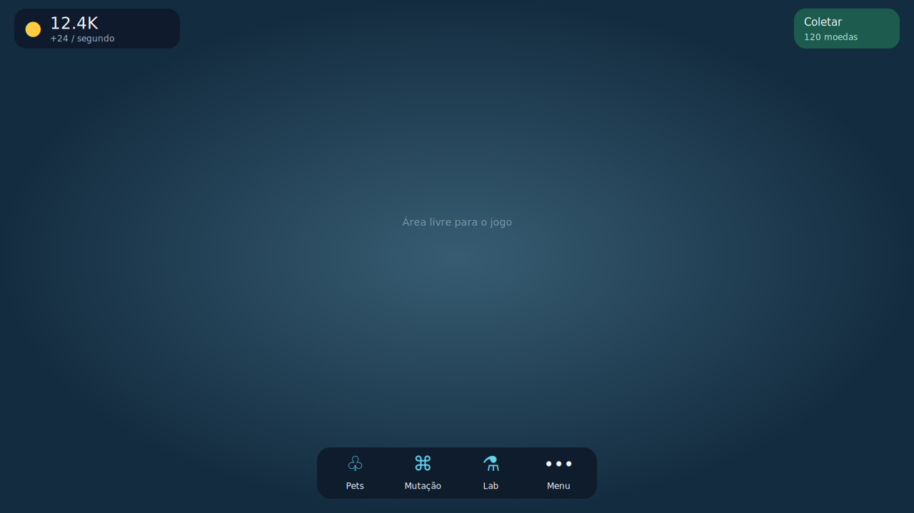

# Clean HUD

Implemented on `feature/clean-hud`, independently of the world-remaster branch.

## Visible changes
- Four permanent actions: Pets, Mutation, Lab and Menu.
- One compact coin balance with production rate.
- Collect appears only when at least one coin is available; existing travel/collection logic is retained.
- First-pet prompt disappears after any pet is placed.
- Secondary destinations live in a dedicated menu: Shop, Missions/daily, Map/travel, Event, Social and Settings.
- One discreet menu notification dot replaces multiple exclamation badges.
- Unavailable gem/mutagen balances, duplicate pet/base summaries, permanent event timer and always-visible social/server counts are removed from the HUD.
- Healthy save state is quiet; temporary Studio progress and unhealthy saving remain visible.
- Thin, muted borders replace stacked neon outlines; hover/gamepad focus remains visible.
- Menus keep their existing gameplay controllers, now with quieter shared buttons.

## Input and accessibility
Touch targets are at least 44 px. Portrait touch screens reserve 132 px below the toolbar for Roblox movement/jump controls. The layout uses the ScreenGui safe content area instead of drawing over the Roblox top bar.
M/Y opens the menu. B/Esc returns, and LB/RB changes pages only while a game menu is open. Focus restores to the dock on close and moves away from contextual controls when they disappear. Reduced-motion preferences remain respected.

## Validation
Cloud CI compiles all game Luau and exercises nine viewport sizes, rectangle separation, touch-target bounds, safe-control reserve, first-pet placement, collectible thresholds, save/demo status, daily/quest/discovery/event indicators.
Actual Roblox visual, touch and controller playtests are still required. No Studio import, running-game change, publication or atlas upload is claimed. The existing optional atlas remains supported; no invented asset IDs are used.

## Review in Studio
Sync this branch to a recoverable copy. Verify desktop, 390x844 portrait and 750x381 landscape including Roblox safe insets. Test gamepad focus through every menu, B/Esc hierarchy, touch scrolling, collection failures, loading, save failure, first placement and live event state. Compare with the old HUD from main `13b53c1d4987dc2f694e83cde01f9433fe28b855`.

This branch does not change persistence, economy, creatures or world geometry.

## Verified cloud run
[Run 39537335370](https://github.com/coredev-byte/Mutant-mayhem/actions/runs/39537335370) passed all compilation, layout/state and actual HUD/controller callback tests. Callback tests use UI API doubles; they do not simulate Roblox rendering or physical input devices.

This is a layout illustration generated from the actual HUD instance tree through the test harness. It uses substitute icon glyphs and a neutral background; it is not a Roblox screenshot. Desktop, portrait and landscape SVG/PNG versions are also saved in the run artifact.
